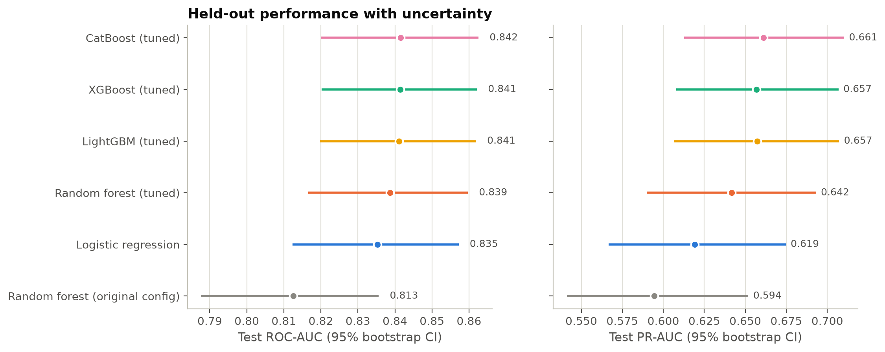
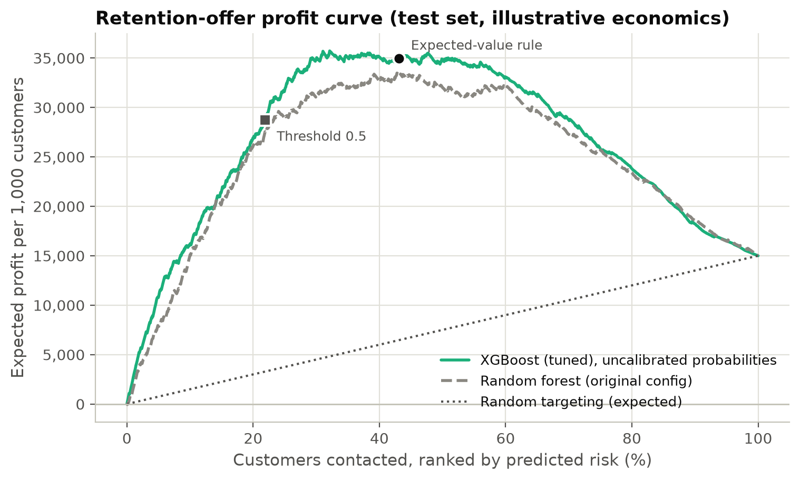
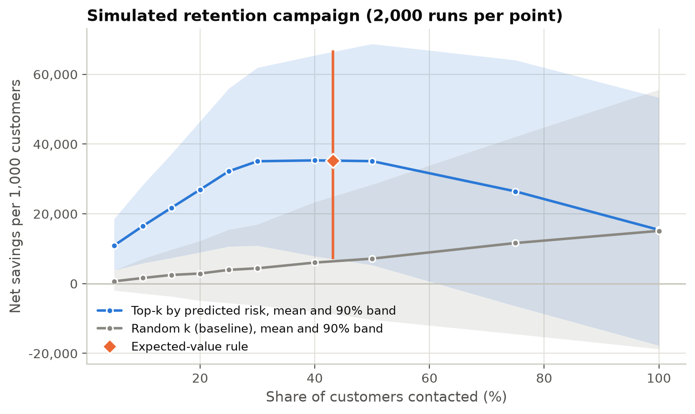
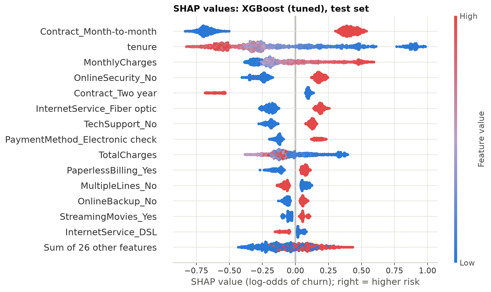
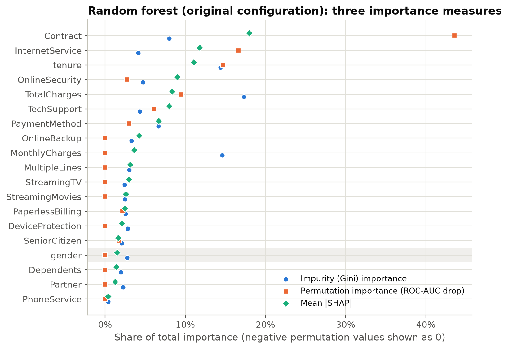
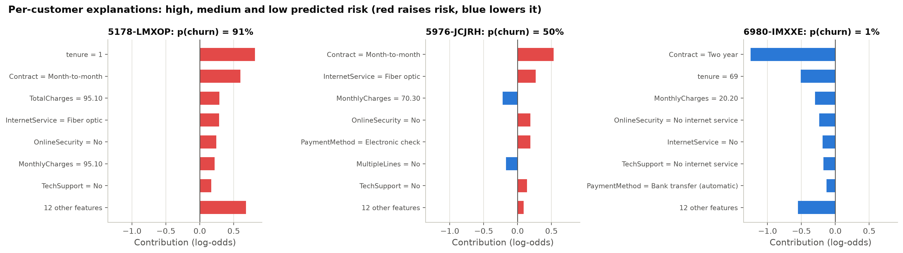
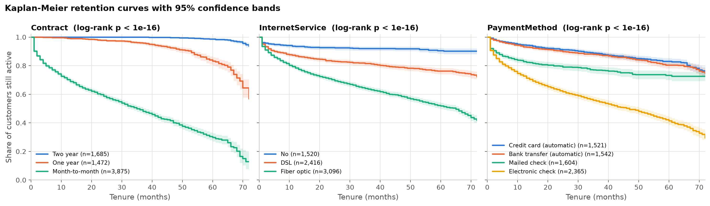
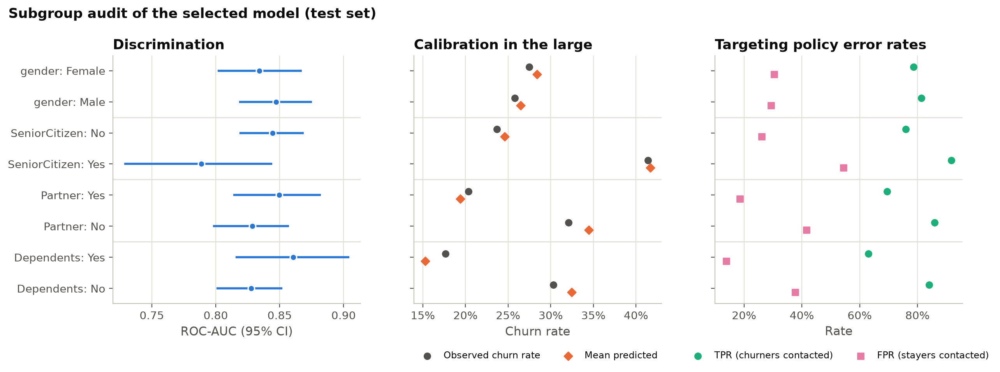

# Detailed results

Full results, methods notes and references for the customer churn analysis. For a short
overview, installation and the main commands, see the [README](../README.md).

Which telecom customers are about to leave, why, and is it worth paying to keep them?
This project answers those three questions on the public IBM Telco Customer Churn data
(7,043 customers) with a reproducible, tested pipeline:

1. **Prediction.** Logistic regression, random forest, XGBoost, LightGBM and CatBoost,
   each tuned with Optuna under 5-fold cross-validation, compared on a held-out test set
   with bootstrap confidence intervals.
2. **Decisions.** Calibrated probabilities feed an expected-value rule for a retention
   offer, a Monte Carlo campaign simulation and a sensitivity analysis of the offer's
   economics.
3. **Explanations.** SHAP values (global, interactions, per customer), a comparison of
   three feature-importance methods, survival analysis of time to churn, and a subgroup
   audit.

A FastAPI service returns a churn probability, a recommendation and the top reasons for
each customer. Everything runs with `make data all`.

The repository started as a single notebook (Random Forest + SHAP, about 80% accuracy).
That notebook is kept in [`notebooks/`](../notebooks/churn_analysis.ipynb), fixed and
re-executed; [What changed](#what-changed-from-the-first-version) lists the corrections.

## Key results

All numbers are on the same stratified 20% test split (1,407 customers, 374 churners)
unless noted, and come from [`results/`](../results/). Intervals are 95% percentile
bootstrap intervals (2,000 resamples).

### 1. Prediction: tuned boosting helps a little; the baseline is strong

| Model | CV ROC-AUC (mean ± sd) | Test ROC-AUC [95% CI] | Test PR-AUC [95% CI] | Brier |
|---|---|---|---|---|
| Majority class | 0.500 | 0.500 | 0.266 | 0.195 |
| Random forest, original settings | 0.827 ± 0.008 | 0.813 [0.788, 0.836] | 0.594 [0.541, 0.652] | 0.150 |
| Logistic regression (tuned) | 0.846 ± 0.006 | 0.835 [0.812, 0.857] | 0.619 [0.567, 0.675] | 0.140 |
| Random forest (tuned) | 0.850 ± 0.006 | 0.839 [0.817, 0.860] | 0.642 [0.590, 0.693] | 0.165 |
| **XGBoost (tuned, selected)** | **0.852 ± 0.006** | **0.841 [0.820, 0.862]** | **0.657 [0.608, 0.707]** | **0.137** |
| LightGBM (tuned) | 0.852 ± 0.005 | 0.841 [0.820, 0.862] | 0.657 [0.606, 0.707] | 0.138 |
| CatBoost (tuned) | 0.852 ± 0.006 | 0.842 [0.820, 0.863] | 0.661 [0.613, 0.710] | 0.137 |

* The selected model (best mean CV ROC-AUC, chosen without looking at the test set) is
  XGBoost. The three boosting libraries are indistinguishable.
* Against a tuned logistic regression the gain is small: +0.006 ROC-AUC, paired bootstrap
  CI [+0.000, +0.012]. The notebook's random-forest settings are 0.023 below logistic
  regression ([−0.036, −0.009]), so most of the improvement over the first version comes
  from tuning, not from the choice of library.
* The original "80% accuracy" should be read against the 73% a model gets by predicting
  that nobody churns. At the default 0.5 threshold the original model found 48% of
  churners. Accuracy at 0.5 is the wrong target for this problem; the next section uses
  costs instead.
* XGBoost was trained on an NVIDIA GPU, which did not pay off at this size: a fit of the
  tuned model took 0.86 s on the GPU vs 0.56 s on 8 CPU threads, and CatBoost 11.9 s vs
  1.4 s ([`results/gpu_cpu_timing.csv`](../results/gpu_cpu_timing.csv)).



### 2. Decisions: target by expected value, not by a 0.5 threshold

The tuned XGBoost is already well calibrated (expected calibration error 0.024; sigmoid
and isotonic recalibration did not improve the out-of-fold Brier score), so its
probabilities are used directly. With the illustrative campaign economics in
[`configs/default.yaml`](../configs/default.yaml) (a retained customer is worth 12 months of
charges, the offer costs one month of charges, contact costs 5, and 30% of would-be
churners accept), contacting a customer is worth

`EV = p · g · (V − d) − (1 − p) · d − f`

(`p` churn probability, `g` acceptance rate, `V` value, `d` incentive, `f` contact cost).

| Policy (test set) | Contacted | Churners reached | Profit per 1,000 customers [95% CI] |
|---|---|---|---|
| Contact everyone | 100% | 100% | 15,004 [7,814, 22,978] |
| Threshold 0.5 | 22% | 53% | 28,706 [23,765, 33,893] |
| Profit-optimal threshold 0.215 (chosen on training folds) | 48% | 85% | 34,939 [28,607, 41,490] |
| **Expected-value rule** | **43%** | **80%** | **34,957 [28,844, 41,234]** |
| Oracle (knows who churns; upper bound) | 27% | 100% | 63,134 [57,393, 69,529] |

The expected-value rule earns 6,252 more per 1,000 customers than the 0.5 threshold
(paired bootstrap CI [2,381, 10,164]). It contacts about twice as many customers,
because a missed churner costs far more than an unneeded offer.



**Campaign simulation.** 2,000 simulated campaigns per budget resample the customers and
draw the acceptance rate from a Beta(6, 14) prior (mean 30%). Targeting the riskiest 40%
saves 35,300 per 1,000 customers on average (90% interval 7,900 to 65,400; probability of
a loss 1.1%), against 6,000 for contacting a random 40%. The
[sensitivity grid](../figures/campaign_sensitivity.png) shows how much this depends on the
offer: at 10% acceptance and a one-month incentive the expected-value rule earns about
4,900 per 1,000 customers; at 50% acceptance and half a month, about 90,600. These are
assumptions, not estimates; change `business:` in the config to match a real offer.



### 3. Why customers leave

**Global drivers (SHAP, tuned XGBoost, one-hot levels summed per feature).** Contract
type dominates (mean |SHAP| 0.71 log-odds), followed by tenure (0.40), internet service
(0.25), online security (0.24) and monthly charges (0.22). The strongest pairwise
interaction is contract × tenure: the risk of a short tenure is concentrated in
month-to-month customers.



**The original business insights hold up.** Each claim in
[`business_insights.md`](../business_insights.md) was checked against raw churn rates and
against the direction of the SHAP values ([`results/insight_validation.md`](../results/insight_validation.md)):

| Claim | Observed churn rate | Model agrees |
|---|---|---|
| Short tenure → more churn | 47.7% (≤ 12 months) vs 17.1% (> 12 months) | yes |
| Higher monthly charges → more churn | 32.9% (top quartile) vs 11.3% (bottom quartile) | yes |
| Long contracts → less churn | 2.8% two-year, 11.3% one-year, 42.7% month-to-month | yes |
| Fiber optic → more churn | 41.9% fiber vs 19.0% DSL | yes |
| Tech support / online security → less churn | 15.2% / 14.6% with vs 41.6% / 41.8% without (internet customers) | yes |

These are associations in observational data. Fiber customers also pay more, and
customers who buy add-ons may differ in other ways; none of the numbers says what a
change of contract or service would cause.

**Feature-importance methods disagree.** The first version ranked features by random
forest impurity importance, which put `gender_Male` 7th. For the same random-forest
settings, permutation importance (drop in test ROC-AUC) is slightly negative for gender
and SHAP ranks it 16th of 19 features. Impurity importance favours continuous features:
`MonthlyCharges` is 2nd by impurity but 17th by permutation, because tenure, internet
service and total charges carry the same information. Rank correlation between impurity
and permutation importance is 0.51.



**Per customer.** `make explain` writes a reason-code report for the five riskiest test
customers ([example](../results/customer_reports/1069-XAIEM.md)); the API returns the same
reasons with every prediction.



### 4. When customers leave: survival analysis

Kaplan-Meier curves treat tenure as follow-up time (see the snapshot caveat under
[Limitations](#limitations)). By that estimate half of month-to-month customers have left
by month 35; for one- and two-year contracts the median is not reached within
72 months (restricted mean time without churn over 72 months: 36.3, 66.4 and 71.5 months).
A penalised Cox model fitted on the training split ranks test customers well
(concordance 0.852). Adjusted for everything else, a two-year contract has a hazard
ratio of 0.08 [0.06, 0.10] and fiber optic 1.50 [1.29, 1.74]; electronic-check payment,
strongly associated with churn on its own, is no longer significant (1.10 [0.95, 1.28]).
Six covariates fail the proportional-hazards test (contract, payment method and some
add-ons), so the hazard ratios are averages over tenure; a contract-stratified model is
reported as a check ([`results/survival_summary.json`](../results/survival_summary.json)).



### 5. Subgroup audit

The model is equally well calibrated across gender, senior-citizen, partner and
dependents groups (observed vs mean predicted churn within 2.4 points). Discrimination is
lower for senior citizens (ROC-AUC 0.79 [0.73, 0.84] vs 0.85 [0.82, 0.87]; the
difference's CI is [−0.120, +0.003]), and because their churn rate is higher (41% vs
24%), the expected-value rule contacts 70% of them vs 38% of other customers, with a
false-positive rate of 0.54 vs 0.26. Whether that is acceptable depends on what the offer
is. Removing gender and senior-citizen status from the inputs changes test ROC-AUC by
−0.001 [−0.002, +0.000].



## What changed from the first version

* **SHAP figure was wrong.** With SHAP ≥ 0.45, `TreeExplainer.shap_values()` on a
  scikit-learn classifier returns one array of shape (customers, features, classes).
  Passed to `summary_plot`, a 3-D array is read as *interaction* values, so the committed
  `shap_summary.png` showed only two features (tenure and SeniorCitizen). The notebook now
  keeps the positive class; old and corrected figures:
  [`figures/original/shap_summary_original.png`](../figures/original/shap_summary_original.png),
  [`figures/notebook/shap_summary.png`](../figures/notebook/shap_summary.png).
* **The notebook did not run top to bottom.** Cells had been executed out of order; run in
  order, one-hot encoding renamed `Churn` and the next cell raised `KeyError`. Fixed and
  re-executed; the Random Forest numbers are unchanged.
* The data is downloaded and checksum-verified by a script instead of a hard-coded Colab
  path; dependencies are pinned; every step is a tested function behind `make`.
* Added tuning and model comparison with uncertainty, calibration and cost-sensitive
  decisions, campaign simulation, survival analysis, SHAP interactions and per-customer
  reports, a subgroup audit, an API, tests and CI.

The release history is in [CHANGELOG.md](../CHANGELOG.md).

## Limitations

* **Snapshot data.** `Churn` means "left within the last month"; customers who left
  earlier are not in the file. The survival analysis therefore treats tenure as
  follow-up time as an approximation: hazard ratios and comparisons between groups are
  informative, but the curves are not the retention of a real sign-up cohort.
* **Associations, not effects.** SHAP values and hazard ratios describe the model and the
  data. They do not say that moving a customer to a longer contract would keep them; that
  needs an experiment or a causal design.
* **Assumed economics.** Profit figures depend on the acceptance rate, incentive and
  customer value in the config. Across the sensitivity grid the expected-value rule stayed
  within 3,000 per 1,000 customers of the best contact share picked with hindsight, but
  the amounts themselves do not transfer to a real company.
* **One dataset, one split.** The test set has 374 churners, which is why the intervals
  are a few points wide. Differences between the boosting libraries are within noise.
* **Sample data.** The dataset is IBM sample data, not records from a named company;
  the conclusions illustrate the method rather than a real market.

## Scoring API

Score customers with the API:

```bash
make export         # packages the selected model as models/churn_model.joblib
make serve          # http://127.0.0.1:8000/docs
curl -s -X POST http://127.0.0.1:8000/predict -H 'Content-Type: application/json' \
  -d '{"customers": [{"gender": "Female", "SeniorCitizen": 0, "Partner": "No", "Dependents": "No",
       "tenure": 2, "PhoneService": "Yes", "MultipleLines": "No", "InternetService": "Fiber optic",
       "OnlineSecurity": "No", "OnlineBackup": "No", "DeviceProtection": "No", "TechSupport": "No",
       "StreamingTV": "Yes", "StreamingMovies": "No", "Contract": "Month-to-month",
       "PaperlessBilling": "Yes", "PaymentMethod": "Electronic check",
       "MonthlyCharges": 85.5, "TotalCharges": 171.0}]}'
```

Or as a container (after `make export`): `docker build -t churn-api . && docker run -p 8000:8000 churn-api`.

## Reproducing the results

Every number and figure in this document comes from `make all` with `configs/default.yaml`
(seed 42). Individual stages:

| Command | What it does | Main outputs |
|---|---|---|
| `make original` | re-runs the notebook's pipeline exactly | `results/original_baseline.json` |
| `make eda` | churn rate by segment | `figures/eda_churn_rates.png` |
| `make benchmark` | Optuna tuning (60 trials x 5-fold CV per model), test evaluation with bootstrap CIs | `results/benchmark.md`, `results/benchmark.csv`, `results/tuning/` |
| `make decide` | calibration, policy comparison | `results/calibration.csv`, `results/decision_policies.md` |
| `make simulate` | Monte Carlo campaign simulation and sensitivity grid | `results/campaign_*.csv` |
| `make survival` | Kaplan-Meier, log-rank, Cox PH, PH tests | `results/survival_*`, `results/cox_*` |
| `make explain` | SHAP global, interactions, per-customer reports, insight check | `results/explain_summary.json`, `results/customer_reports/` |
| `make fairness` | subgroup audit and "unaware" ablation | `results/fairness_*` |
| `make export` | API bundle and a recorded example request/response | `models/churn_model.joblib`, `results/api_example.json` |
| `make notebook` | re-executes the original notebook | `notebooks/churn_analysis.ipynb` |

`make smoke` runs all stages on synthetic data in about a minute (outputs in `build/smoke/`).
`make test` and `make lint` run the test suite and ruff, as CI does.

XGBoost uses a GPU when one is visible (`compute.device: auto`); set
`compute.device: cpu` to force CPU. CatBoost runs on CPU by default
(`compute.catboost_device`) because it was several times slower on the GPU for this
table. GPU and CPU runs can differ in the last decimals. The full `make all` took about
30 minutes on a shared server (8 CPU threads, one GPU), most of it Optuna tuning.

## Project structure

```
.
├── configs/
│   ├── default.yaml          # all settings: seed, CV, trials, business assumptions
│   └── smoke.yaml            # tiny synthetic-data run for CI
├── src/churn_analysis/
│   ├── data.py               # download (checksum-verified), schema checks, cleaning, split
│   ├── features.py           # shared preprocessing; one-hot <-> original feature mapping
│   ├── models.py             # model zoo and Optuna search spaces
│   ├── tuning.py             # Optuna + stratified CV
│   ├── evaluate.py           # metrics, ECE, bootstrap and paired-bootstrap CIs
│   ├── benchmark.py          # stage: original reproduction + model benchmark
│   ├── decision.py           # stage: calibration + cost-sensitive targeting
│   ├── campaign.py           # stage: Monte Carlo campaign simulation
│   ├── survival.py           # stage: Kaplan-Meier, log-rank, Cox PH
│   ├── explain.py            # stage: SHAP explanations and insight checks
│   ├── fairness.py           # stage: subgroup audit
│   ├── serving.py, api.py    # model bundle + FastAPI service
│   ├── eda.py, plotting.py   # descriptive figure; shared figure style
│   ├── synthetic.py          # schema-valid synthetic data for tests
│   └── cli.py                # `churn <stage>` / `python -m churn_analysis <stage>`
├── notebooks/churn_analysis.ipynb   # original analysis (fixed, re-executed)
├── tests/                    # pytest suite (synthetic data, CPU only)
├── results/                  # small CSV/JSON/Markdown outputs of the full run
├── figures/                  # figures of the full run; figures/original/ = first version
├── docs/RESULTS.md           # detailed results (this document)
├── scripts/download_data.sh
├── Dockerfile, Makefile, pyproject.toml
├── requirements.txt, requirements-dev.txt
└── .github/workflows/ci.yml  # ruff + pytest on every push / pull request
```

Downloaded data (`data/`), fitted models (`models/`) and intermediate predictions
(`artifacts/`) are not committed; `make data all` recreates them.

## Dataset

[Telco Customer Churn](https://www.kaggle.com/datasets/blastchar/telco-customer-churn)
(Kaggle, uploaded by BlastChar; described there as IBM sample data). 7,043 customers, 21
columns: demographics, subscribed services, account details (tenure in months, contract,
payment method, monthly and total charges) and `Churn` ("customers who left within the
last month"). Eleven customers with `tenure = 0` have a blank `TotalCharges`; like the
original notebook, the pipeline drops them (7,032 rows remain; set
`data.drop_missing_total_charges: false` to keep them with `TotalCharges = 0`).

`make data` downloads the file with `kagglehub`; if that fails it uses the copy in IBM's
public repository
[IBM/telco-customer-churn-on-icp4d](https://github.com/IBM/telco-customer-churn-on-icp4d)
(`data/Telco-Customer-Churn.csv`). The two files differ only in line endings, and the
script checks a SHA-256 of the normalised content.

**License.** The Kaggle page lists the license as "Data files © Original Authors". The
IBM GitHub repository is licensed Apache-2.0 according to GitHub's metadata. The data is
not redistributed here; check the terms before reusing it.

## References

* Lundberg, S. M., & Lee, S.-I. (2017). A unified approach to interpreting model
  predictions. *Advances in Neural Information Processing Systems 30*.
  [arXiv:1705.07874](https://arxiv.org/abs/1705.07874)
* Lundberg, S. M., Erion, G., Chen, H., DeGrave, A., Prutkin, J. M., et al. (2020). From
  local explanations to global understanding with explainable AI for trees. *Nature
  Machine Intelligence*, 2(1), 56–67.
  [doi:10.1038/s42256-019-0138-9](https://doi.org/10.1038/s42256-019-0138-9)
* Chen, T., & Guestrin, C. (2016). XGBoost: A scalable tree boosting system. *Proceedings
  of the 22nd ACM SIGKDD International Conference on Knowledge Discovery and Data Mining*,
  785–794. [doi:10.1145/2939672.2939785](https://doi.org/10.1145/2939672.2939785)
* Akiba, T., Sano, S., Yanase, T., Ohta, T., & Koyama, M. (2019). Optuna: A
  next-generation hyperparameter optimization framework. *Proceedings of the 25th ACM
  SIGKDD International Conference on Knowledge Discovery & Data Mining*, 2623–2631.
  [doi:10.1145/3292500.3330701](https://doi.org/10.1145/3292500.3330701)
* Verbraken, T., Verbeke, W., & Baesens, B. (2013). A novel profit maximizing metric for
  measuring classification performance of customer churn prediction models. *IEEE
  Transactions on Knowledge and Data Engineering*, 25(5), 961–973.
  [doi:10.1109/TKDE.2012.50](https://doi.org/10.1109/TKDE.2012.50)
* Kaplan, E. L., & Meier, P. (1958). Nonparametric estimation from incomplete
  observations. *Journal of the American Statistical Association*, 53(282), 457–481.
  [doi:10.1080/01621459.1958.10501452](https://doi.org/10.1080/01621459.1958.10501452)
* Cox, D. R. (1972). Regression models and life-tables. *Journal of the Royal Statistical
  Society: Series B*, 34(2), 187–202.
  [doi:10.1111/j.2517-6161.1972.tb00899.x](https://doi.org/10.1111/j.2517-6161.1972.tb00899.x)
* Davidson-Pilon, C. (2019). lifelines: survival analysis in Python. *Journal of Open
  Source Software*, 4(40), 1317. [doi:10.21105/joss.01317](https://doi.org/10.21105/joss.01317)

Software: [scikit-learn](https://scikit-learn.org), [XGBoost](https://xgboost.ai),
[LightGBM](https://github.com/microsoft/LightGBM), [CatBoost](https://catboost.ai),
[SHAP](https://github.com/shap/shap), [Optuna](https://optuna.org),
[lifelines](https://lifelines.readthedocs.io), [FastAPI](https://fastapi.tiangolo.com).
Versions are pinned in [`requirements.txt`](../requirements.txt).
